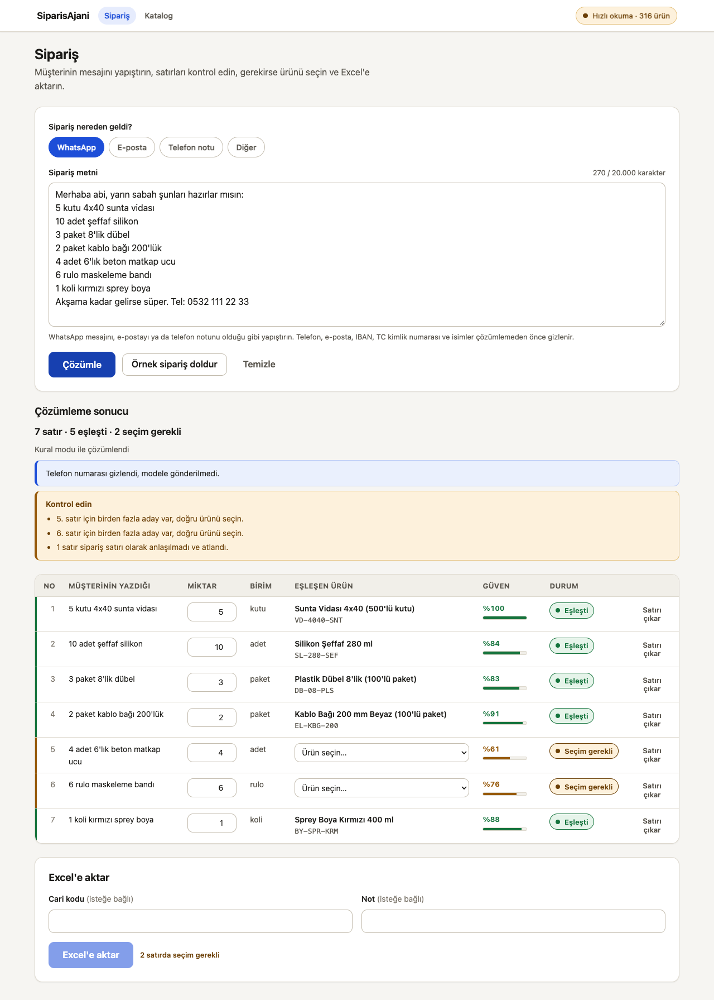
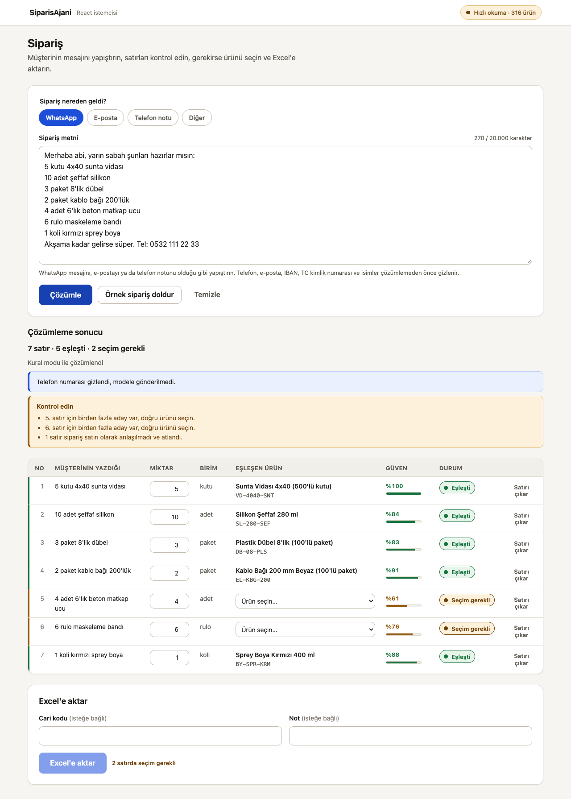

**Türkçe:** [README.tr.md](README.tr.md)

# SiparisAjani

[](https://github.com/Saudade01/siparis-ajani/actions/workflows/ci.yml)
[](LICENSE)

SiparisAjani reads the free-text orders wholesalers get over WhatsApp, email, or a note taken by phone, matches each line to a product catalog, and produces an Excel file for ERP import once a person confirms it.

I built this for a real problem: wholesalers in Istanbul type these orders into their ERP by hand, line by line. Right now the project is in the field-validation stage — the job this week is running live demos and measuring how much time a pilot actually saves, not adding more features.

## How it works

```
text → mask personal data → split into lines → match against catalog (confidence score)
  → human picks the product when it's unclear → correction is remembered → Excel
```

The text goes through a masker first — phone numbers, emails, IBANs, national ID numbers, and names (including salutations like "Hasan Bey") are replaced before anything touches a model or a rule engine. Each line then gets a confidence score against the catalog: above 0.80 with a clear margin over the second candidate is an automatic match, below 0.45 is "not found," and everything in between is left for a person to pick from up to three alternatives. When someone corrects a match, that correction is saved so the same free-text product name resolves the same way next time.

## Screenshots

Main flow, real output from a synthetic order:



7 lines came in, 5 matched automatically, 2 needed a manual pick, and the phone number was masked before parsing.

Same flow from the React client:



## Architecture

```
Blazor Server UI (:5090) ┐
React client     (:5173) ┴──HTTP──> Minimal API (:5080) ──> Infrastructure ──> Core ──> Contracts
```

`Core` is plain .NET — no HTTP client, no file system, no SDK — so matching and masking logic can be unit-tested without any of that. `Infrastructure` holds the things that touch the outside world: the Claude client, the Excel exporter, and EF Core with SQLite for the catalog and correction history. `Contracts` is the DTO and route project the API and the Blazor UI reference directly; the React client isn't a project reference, it works from a hand-written TypeScript copy of the same shapes (`clients/web-react/src/api/types.ts`).

There are two UIs on purpose. Blazor Server needs a live connection to the server the whole time, which is awkward on a phone or tablet with a weak signal at a wholesaler's counter. The React client is a static build that talks to the same API and degrades better in the field. It's a second client, not a rewrite — the Blazor UI is still where the catalog CSV gets uploaded.

## Two ways to read an order

By default the API uses a rule-based parser: regex and heuristics, no API key, works offline. It's what CI and the test suite run against.

If `Anthropic:Enabled` is set and a key is configured, the API calls Claude instead, with structured JSON output. Before any text reaches the model, the masking step above runs, and a second filter strips greetings and signature lines so only the product lines go out. This mode is off by default for KVKK (Turkish data protection law) reasons and has only ever been run against synthetic data — see Known gaps.

## Numbers

212 tests pass. Accuracy is measured against 20 synthetic sample orders in `tests/SiparisAjani.Core.Tests/ExtractionAccuracyTests.cs`, run in rule-based mode (no model call):

- Wrong-match rate: **1.4%** — this is the metric the build actually enforces; the test fails above 15%.
- Line accuracy: **80%** — tracked and reported, doesn't fail the build.
- Catalog used for the test: 316 hardware-store products (`data/katalog/hirdavat-ornek.csv`).

These are synthetic numbers, not field numbers. I expect accuracy to drop on real order text.

## Running it

```bash
./scripts/dev.sh                 # API (:5080) + Blazor UI (:5090)
./scripts/dev.sh --with-react    # same, plus the React client (:5173)
docker compose up
dotnet test SiparisAjani.slnx
```

Claude key is optional:

```bash
dotnet user-secrets set "Anthropic:ApiKey" "<key>" --project src/SiparisAjani.Api
```

Without a key (or with `Anthropic:Enabled: false`), the rule-based parser runs.

## Project structure

```
src/SiparisAjani.Contracts/      DTOs and API routes (shared contract)
src/SiparisAjani.Core/           Matching, masking, parsing — pure .NET, no I/O
src/SiparisAjani.Infrastructure/ Claude client, Excel export, EF Core + SQLite
src/SiparisAjani.Api/            Minimal API (:5080)
src/SiparisAjani.Web/            Blazor Server UI (:5090)
clients/web-react/               React + TypeScript client (:5173)
tests/                           Core.Tests, Api.Tests
data/                            Synthetic sample orders and a sample catalog
docs/                            ADRs, API contract
scripts/                         dev.sh, check.sh
```

## Known gaps

The Excel export's column layout is a guess — I haven't sat down with a real Logo export template yet, so the defaults in `LogoExport:Columns` are unverified. The Claude parsing path has never been run against the real Anthropic API, only tested with the key unset. The rule-based parser can't handle aggregate phrasing like "15 of these in total" or split quantities like "5 each of the following," it just misses those lines. Catalog search is a plain `LIKE` scan; it works fine at 316 rows and won't scale to a large distributor's catalog. The CSV catalog upload screen only exists in the Blazor UI, not in the React client. The catalog is cached in the process, which assumes a single API instance. There's no login and no multi-tenant support — one catalog, one set of corrections.

## What's next

Getting a real Logo export template from a pilot wholesaler and matching it exactly, a Mikro ERP integration, and a background worker with a queue and Postgres instead of the current in-process SQLite setup.

## License

MIT — see [LICENSE](LICENSE).
