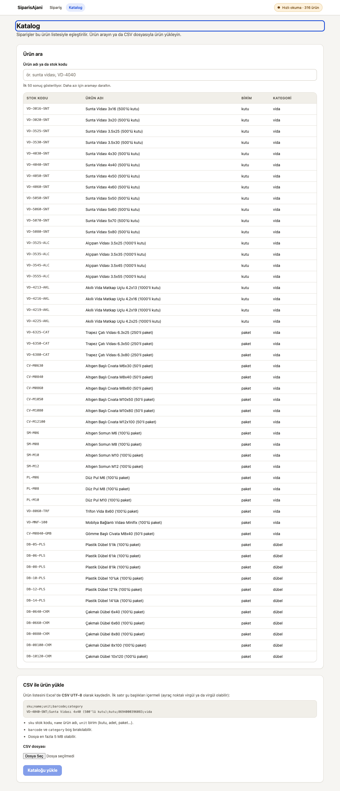

**English:** [README.md](README.md)

# SiparisAjani

[](https://github.com/Saudade01/siparis-ajani/actions/workflows/ci.yml)
[](LICENSE)

Toptancıların WhatsApp, e-posta ve telefon notuyla gelen serbest metin siparişlerini okuyup ürün kataloğuyla eşleştiren, insan onayından sonra ERP'ye aktarılacak Excel dosyasını üreten ajan.

Bunu gerçek bir ihtiyaç için yazdım: İstanbul'daki toptancılar bu siparişleri elle, satır satır ERP'ye giriyor. Şu an saha doğrulama aşamasındayız — bu haftaki iş sahada demo yapmak ve pilotta gerçekten ne kadar süre kazandırdığını ölçmek, yeni özellik eklemek değil.

## Nasıl çalışır

```
metin → kişisel veri maskeleme → satırlara ayırma → katalog eşleştirme (güven skoru)
  → belirsiz satırda insan seçimi → düzeltme hatırlanır → Excel
```

Metin önce maskeleyiciden geçer: telefon, e-posta, IBAN, TC kimlik numarası ve isimler ("Hasan Bey" gibi hitaplar dahil) modele ya da kural motoruna gitmeden önce temizlenir. Her satır kataloğa karşı bir güven skoru alır: 0,80 üstü ve ikinci adaydan belirgin farkla önde olan otomatik eşleşir, 0,45 altı "bulunamadı" olur, arası en fazla üç alternatiften birinin insan tarafından seçilmesine kalır. Biri bir eşleşmeyi düzelttiğinde bu düzeltme kaydedilir; aynı serbest metin ürün adı bir sonraki seferde aynı şekilde çözülür.

## Ekran görüntüleri

Ana akış, sentetik bir siparişin gerçek çıktısı:


7 satır geldi, 5'i otomatik eşleşti, 2'si seçim istedi, telefon numarası çözümlemeden önce gizlendi.

Aynı akış React istemcisinden:


Katalog ekranı (arama ve CSV yükleme, yalnızca Blazor arayüzünde var):



## Mimari

```
Blazor Server arayüzü (:5090) ┐
React istemcisi        (:5173) ┴──HTTP──> Minimal API (:5080) ──> Infrastructure ──> Core ──> Contracts
```

`Core` saf .NET'tir — HTTP istemcisi, dosya erişimi, SDK yok — böylece eşleştirme ve maskeleme mantığı bunlardan bağımsız test edilebiliyor. `Infrastructure` dış dünyaya dokunan kısımları taşır: Claude istemcisi, Excel dışa aktarıcı, katalog ve düzeltme geçmişi için EF Core + SQLite. `Contracts`, API'nin ve Blazor arayüzünün doğrudan referans verdiği DTO ve rota projesi; React istemcisi bu projeye referans vermez, aynı sözleşmenin elle yazılmış TypeScript kopyasını kullanır (`clients/web-react/src/api/types.ts`).

İki arayüz olması bilinçli bir tercih. Blazor Server sürekli açık bir bağlantı istiyor, bu da sahada zayıf internetle telefon/tabletten kullanırken sorun çıkarıyor. React istemcisi statik dosya olarak dağıtılabiliyor ve zayıf bağlantıda daha iyi dayanıyor. Bu ikinci bir istemci, yeniden yazım değil — katalog CSV yükleme hâlâ yalnızca Blazor arayüzünde.

## İki okuma modu

Varsayılan: kural tabanlı ayrıştırıcı — regex ve sezgisel kurallar, anahtar gerekmez, internetsiz çalışır. CI ve testler bu modu kullanıyor.

`Anthropic:Enabled` açık ve bir anahtar tanımlıysa API, Claude'u çağırıyor, yapılandırılmış JSON çıktısıyla. Metin modele gitmeden önce yukarıdaki maskeleme çalışıyor, ayrıca ikinci bir filtre selamlaşma ve imza satırlarını ayıklayıp modele yalnızca ürün satırlarını gönderiyor. Bu mod KVKK nedeniyle varsayılan kapalı ve şu ana kadar yalnızca sentetik veriyle çalıştırıldı — bkz. Bilinen eksikler.

## Sayılar

212 test geçiyor. Doğruluk, `tests/SiparisAjani.Core.Tests/ExtractionAccuracyTests.cs` içinde 20 sentetik örnek sipariş üzerinde, kural tabanlı modda (model çağrısı olmadan) ölçülüyor:

- Yanlış eşleşme oranı: **%1,4** — testi kıran asıl ölçü bu; %15'i geçerse derleme kırılır.
- Satır doğruluğu: **%80** — raporlanır ama derlemeyi kırmaz.
- Test için kullanılan katalog: 316 hırdavat ürünü (`data/katalog/hirdavat-ornek.csv`).

Bunlar sentetik sayılar, saha sayısı değil. Gerçek sipariş metninde doğruluğun düşmesini bekliyorum.

## Çalıştırma

```bash
./scripts/dev.sh                 # API (:5080) + Blazor arayüzü (:5090)
./scripts/dev.sh --with-react    # aynısı + React istemcisi (:5173)
docker compose up
dotnet test SiparisAjani.slnx
```

Claude anahtarı isteğe bağlı:

```bash
dotnet user-secrets set "Anthropic:ApiKey" "<anahtar>" --project src/SiparisAjani.Api
```

Anahtar yoksa (ya da `Anthropic:Enabled: false` ise) kural tabanlı ayrıştırıcı çalışır.

## Klasör yapısı

```
src/SiparisAjani.Contracts/      DTO ve API rotaları (paylaşılan sözleşme)
src/SiparisAjani.Core/           Eşleştirme, maskeleme, ayrıştırma — saf .NET
src/SiparisAjani.Infrastructure/ Claude istemcisi, Excel, EF Core + SQLite
src/SiparisAjani.Api/            Minimal API (:5080)
src/SiparisAjani.Web/            Blazor Server arayüzü (:5090)
clients/web-react/               React + TypeScript istemcisi (:5173)
tests/                           Core.Tests, Api.Tests
data/                            Sentetik örnek siparişler ve örnek katalog
docs/                            ADR'ler, API sözleşmesi
scripts/                         dev.sh, check.sh
```

## Bilinen eksikler

Excel aktarımının sütun düzeni tahmin — gerçek bir Logo aktarım şablonuyla henüz karşılaştırmadım, `LogoExport:Columns` altındaki varsayılanlar doğrulanmadı. Claude yolu gerçek Anthropic API'sine karşı hiç çalıştırılmadı, yalnızca anahtar tanımsızken test edildi. Kural tabanlı ayrıştırıcı "toplam 15 olsun" gibi birleştirmeleri ve "5'er adet" gibi dağıtımları çözemiyor, o satırları atlıyor. Katalog araması düz bir `LIKE` taraması; 316 satırda sorun yok ama büyük bir toptancı kataloğunda yetersiz kalır. Katalog CSV yükleme ekranı yalnızca Blazor arayüzünde var, React istemcisinde yok. Katalog süreç içinde önbellekleniyor, bu da tek bir API örneği varsayıyor. Kullanıcı girişi ve çoklu firma desteği yok — tek katalog, tek düzeltme kümesi.

## Sırada ne var

Pilot bir toptancıdan gerçek Logo aktarım şablonunu alıp birebir uyumlu hale getirmek, Mikro ERP entegrasyonu, ve şu anki süreç içi SQLite yerine kuyruk + Postgres ile çalışan bir arka plan işçisi.

## Lisans

MIT — bkz. [LICENSE](LICENSE).
